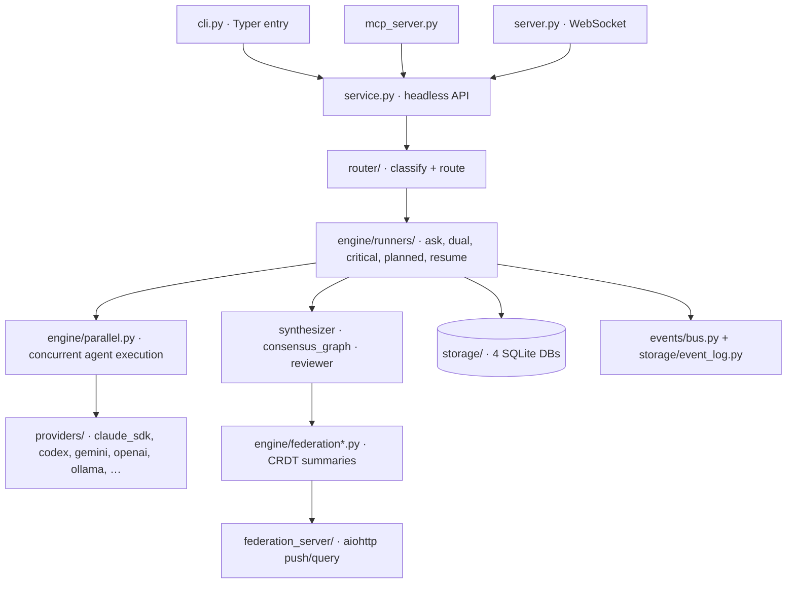

# Orchestra — Architecture Map

**Date:** 2026-07-06 · **Source:** full-system review (3 exploration passes + 4 subsystem audits, spot-checked)
**Scale:** ~29,008 lines of Python across 159 files in `orchestra/` (verified with `wc -l`).

## 1. What Orchestra Is

Orchestra is a multi-agent AI orchestration engine. It dispatches a task to one or more LLM
agents (Claude, Codex, Gemini, OpenAI, Ollama, …), coordinates them through review/consensus
loops, tracks cost and reputation, and persists everything as an event-sourced run history.
Interfaces: a Typer CLI (`orchestra`), an MCP server (Claude Code integration), and a
WebSocket server. (The Textual TUI — "Maestro" et al. — was removed entirely on 2026-07-09.)

## 2. Component Map

## 3. Request Lifecycle (`orchestra ask cdx-deep "task"`)

1. `cli.py` (entry point `orchestra = orchestra.cli:app`, pyproject.toml:49) → `service.py:run_task()`.
2. `router/classifier.py:classify()` labels the task cheap/balanced/deep/extreme (keyword
   heuristics from `router/policy.toml`); `route_task()` returns a `RouteDecision(mode, alias,
   confidence)`. Low-confidence routes can fall through to a local Ollama semantic model;
   `outcome_router.py` re-weights by historical expected value once ≥50 outcomes exist.
3. The mode's runner (`engine/runners/{ask,dual,critical,planned,resume}_runner.py`) builds an
   `OrchestraRun` (models.py) and delegates shared machinery to `engine/runners/common.py`:
   prompt prefixing/context injection, FTS5 semantic-cache lookup, idempotency wrapping
   (`engine/idempotency.py`), PII scrubbing, policy/approval gates.
4. `engine/parallel.py:run_parallel()` executes agents concurrently (asyncio with a
   ThreadPoolExecutor fallback), enforcing budget guards and cancellation; provider resolution
   goes through `providers/fallback.py:resolve(alias)` → a `BaseProvider` subclass invokes the
   model (SDK call or subprocess CLI).
5. Multi-agent modes then run review/verification (`engine/reviewer.py`,
   `_run_verification_loop`), optional red-team injection, and synthesis
   (`engine/synthesizer.py`); `critical` mode can suspend to DB at approval gates and resume
   later (`engine/state_suspension.py`, `resume_runner.py`).
6. `_finalize` (runners/common.py:584) writes the consensus graph, a federation summary, and
   semantic-memory entries; every step emits typed events (events/bus.py, ~30 event types)
   persisted to the event log; artifacts and manifests land in `.orchestra/runs/<run_id>/`.

## 4. Subsystems

| Subsystem | Key files (lines) | Responsibility |
|---|---|---|
| Entry points | `cli.py` (2066), `service.py` (1280), `mcp_server.py` (169), `server.py` (659) | CLI commands; headless API shared by all frontends; MCP bridge; WebSocket dashboard server |
| Engine | `engine/runners/common.py` (1188), `parallel.py` (874), runners (145–566 each) | Run lifecycle, concurrency, budget, approval gates, synthesis |
| Orchestration patterns | `engine/playbook.py`, `cue*.py`, `moderator.py`, `consensus_graph.py`, `worktree_manager.py`, `session_discovery.py` | Markdown playbooks, event-driven triggers (files/cron/GitHub), multi-role debate, git worktree isolation, legacy-session resume |
| Router | `router/classifier.py` (270), `outcome_router.py` (255), `cascade_router.py`, `semantic.py` | Heuristic → learned → semantic routing cascade |
| Providers | `providers/base.py`, `fallback.py`, `registry.py`, `ollama_backends.py`, 9 provider modules | Uniform `run/async_run/stream` contract over SDKs and CLIs; alias→model mapping; availability fallback. Ollama supports multiple named backends (local + remote GPU) via `model@backend` — see `ollama_backends.py` |
| Storage | `storage/db.py` (263), `event_log.py` (430), `memory.py` (729), `fts_cache.py` (325), `migrations.py`, `reputation.py`, `speculation.py` | See §5 |
| Federation | `engine/federation.py`, `federation_crdt.py`, `federation_summarizer.py`, `federation_server/` (~440 total) | Anonymized cross-instance knowledge sharing; **disabled by default** |
| Toolmaker | `toolmaker/validator.py`, `sandbox.py`, `wasm_sandbox.py` | Agent-authored tools: AST blocklist validation + subprocess/WASM sandbox execution |
| Monitoring / Redaction | `monitoring/cost_monitor.py`, `web_dashboard.py`; `redaction/engine.py` | Cost/budget tracking; regex + entropy secret scrubbing before cache/log |

## 5. Persistence: Four SQLite Databases

All WAL-mode, under `.orchestra/` (path resolution walks up from CWD — config.py:23).

| DB | Contents | Why separate |
|---|---|---|
| `orchestra.db` | runs, agents, jobs, alias_reputation, paused_runs, eval_* | Mutable run state, highest write contention |
| `events.db` | Append-only event log with AUTOINCREMENT `seq` | Idempotent replay/audit; independent WAL tuning |
| `memory.db` + `memory_hnsw.idx` | Semantic memory + HNSW vector index (hnswlib) | Expensive rebuilds isolated from run state |
| `fts_cache.db` | FTS5/BM25 response cache (85% similarity threshold) | TTL-based cache, safe to delete |

Connections are opened per operation (no pooling) — see quality-audit.md finding H-STORE-1.

## 6. Cross-Cutting Concerns

- **Config**: `orchestra/config.py` — TOML + `ORCHESTRA_*` env overrides, deep-merged into a
  module-level dict at import time; `validate_config()` checks ranges. Feature switches in
  `.orchestra/config.toml`: `speculation`, `cascade`, `caching`, `federation` off;
  `outcome_routing`, `approval_policies`, `scrubber` on.
- **Idempotency**: `engine/idempotency.py` decorator keyed to the event log; makes crashed runs
  replayable.
- **Approval gates / policy**: `engine/policy_engine.py` + `_evaluate_policy`; runs suspend to
  `paused_runs` and resume via lease.
- **Observability**: `engine/tracer.py` (OTel spans; Jaeger via `docker-compose.yml`),
  cost monitor, web dashboard.

## 7. Dead / Experimental Code Inventory

| Item | Status | Evidence |
|---|---|---|
| `orchestra/tui/` (all versions) + `monitoring/dashboard.py` | **Removed 2026-07-09** | Entire Textual TUI (3,621 lines), `launch`/`dashboard` CLI commands, and the `textual` dependency deleted at user request; web dashboard kept |
| `engine/command_queue.py` | **Dead** | 0 importers |
| `engine/graph.py`, `patterns.py`, `roles.py`, `context_injector.py`, `group_chat.py`, `speculative.py`, `mcp_fastlane.py`, `cue_github.py` | Experimental | ≤2 importers each; several behind disabled config flags |
| `toolmaker/wasm_sandbox.py` | Experimental | WASM alternative to subprocess sandbox |
| `ForestBuildingSystem/` | Unrelated | Unity C# demo target, not part of the engine |

## 8. Known-State Notes

- Federation is opt-in (`federation.enabled = false`); CRDT merge laws were code-verified as
  correct (commutative/associative/idempotent, no in-place mutation) in
  `engine/federation_crdt.py`.
- The repo currently commits its own runtime state (`.orchestra/`, 5,950 files) and test
  artifacts — see `docs/plans/refactor-repo-hygiene.md`.
- Quality findings and prioritized refactors: `docs/quality-audit.md`.
