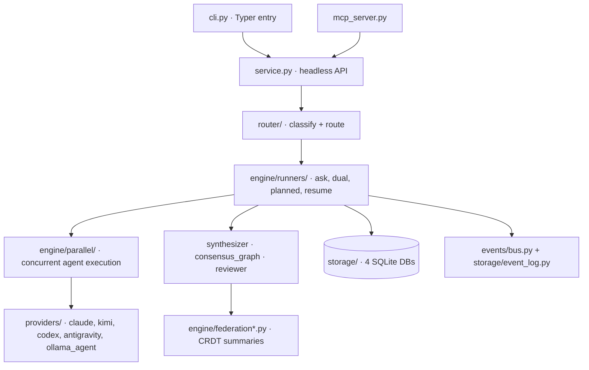

# Orchestra — Architecture Map

**Date:** 2026-07-06, updated 2026-10-20 after the payload slimming (`docs/plans/refactor-payload-slimming.md`)
**Scale:** ~24,800 lines of Python across 118 files in `orchestra/` (verified with `wc -l`).

## 1. What Orchestra Is

Orchestra is a multi-agent AI orchestration engine. It dispatches a task to one or more LLM
agents (Claude CLI, Kimi CLI, Codex CLI, Gemini through the Antigravity CLI, Ollama models),
coordinates them through review/consensus loops, tracks cost and reputation, and persists
everything as an event-sourced run history. Every alias is an agent that can read the project:
it gets the task plus a pointer to `CLAUDE.md`/`AGENTS.md`/`docs/` and reads what it needs.
Interfaces: a Typer CLI (`orchestra`) and an MCP server (`python -m orchestra.mcp_fastmcp`) for
Claude Code, with `orchestra statusline install` for its status line.

## 2. Component Map

## 3. Request Lifecycle (`orchestra ask cdx-deep "task"`)

1. `cli.py` (entry point `orchestra = orchestra.cli:app`, pyproject.toml:49) → `service.py:run_task()`.
2. `router/classifier.py:classify()` labels the task cheap/balanced/deep/extreme (keyword
   heuristics from `router/policy.toml`); `route_task()` returns a `RouteDecision(mode, alias,
   confidence)`. Low-confidence routes can fall through to a local Ollama semantic model;
   `outcome_router.py` re-weights by historical expected value once ≥50 outcomes exist.
3. The mode's runner (`engine/runners/{ask,dual,planned,resume}_runner.py`) builds an
   `OrchestraRun` (models.py) and delegates shared machinery to `engine/runners/common.py`:
   prompt prefixing (the docs pointer; files named in the task are not pasted in), the stored
   answer lookup (the answer cache: same prompt + same alias + same project state), PII scrubbing,
   policy/approval gates.
4. `engine/parallel/__init__.py:run_parallel()` executes agents concurrently (asyncio with a
   ThreadPoolExecutor fallback), enforcing budget guards and cancellation; provider resolution
   goes through `providers/fallback.py:resolve(alias)` → a `BaseProvider` subclass invokes the
   model as a CLI subprocess (Ollama models through the Claude CLI pointed at Ollama's
   Anthropic API, `providers/ollama_agent.py`).
5. Multi-agent modes then run review/verification (`engine/reviewer.py`,
   `_run_verification_loop`), optional red-team injection, and synthesis
   (`engine/synthesizer.py`); a run can suspend to the DB at an approval gate and resume
   later (`engine/state_suspension.py`, `resume_runner.py`).
6. `_finalize` (`engine/runners/common.py`) writes the consensus graph, a federation summary, and
   semantic-memory entries; every step emits typed events (events/bus.py, ~30 event types)
   persisted to the event log; artifacts and manifests land in `.orchestra/runs/<run_id>/`.

## 4. Subsystems

| Subsystem | Key files (lines) | Responsibility |
|---|---|---|
| Entry points | `cli.py` (1870), `service.py` (747), `mcp_server.py` (434), `mcp_fastmcp.py` (370), `statusline.py` (483) | CLI commands; headless API shared by the frontends; MCP tool registry and its FastMCP server; Claude Code status line |
| MCP tools | `engine/mcp_registry.py` (445) | `orchestra_run`, `submit_run`, `wait_for_run`, `get_run` (`detail=true` for the full manifest), `list_runs`, `get_logs` (tail of failed agents; `full=true` for all), `review_changes`, `cancel_run`, `continue_run`, `memory_search`, `request_approval`; run tools return a compact payload |
| Engine | `engine/runners/common.py` (1476), `engine/parallel/` (~1000), runners (55–200 each) | Run lifecycle, concurrency, budget, approval gates, synthesis |
| Orchestration patterns | `engine/supervisor.py`, `planner.py`, `stances.py`, `follow_up.py`, `code_review.py`, `consensus_graph.py`, `isolation.py`, `worktree_manager.py` | Supervise/planned decomposition, consensus stances, follow-up chains, checked code review, git worktree isolation for writing agents |
| Router | `router/classifier.py` (353), `outcome_router.py` (244), `cascade_router.py` | Heuristics, measured tier table, reputation; learned mode choice (off) |
| Providers | `providers/base.py`, `fallback.py`, `registry.py`, `ollama_backends.py`, `claude.py`, `kimi.py`, `codex.py`, `antigravity.py`, `ollama.py`, `ollama_agent.py` | Uniform `run/async_run/stream` contract over agent CLIs; alias→model mapping; availability fallback. Gemini is reached through the Antigravity CLI (`agy-*`; `gmn-*` map there). Ollama models run as agents through the Claude CLI in `--bare` mode with read-only tools (`ollama_agent.py`); `ollama.py` stays for embeddings, health checks and model lists. `model@backend` addresses a named Ollama backend (`ollama_backends.py`) |
| Storage | `storage/db.py` (278), `event_log.py` (430), `memory.py` (842), `fts_cache.py` (385), `migrations.py`, `reputation.py`, `jobs.py` | See §5 |
| Federation | `engine/federation.py`, `federation_crdt.py`, `federation_summarizer.py` | Anonymized cross-instance knowledge summaries; **disabled by default** |
| Monitoring / Redaction | `monitoring/cost_monitor.py`, `monitoring/analytics.py`; `redaction/engine.py` | Cost/budget tracking and reports; regex + entropy secret scrubbing before cache/log |

## 5. Persistence: Four SQLite Databases

All WAL-mode. Project databases live under `.orchestra/` (path resolution walks up from CWD,
`config.py`); the answer cache is shared by all projects.

| DB | Contents | Why separate |
|---|---|---|
| `.orchestra/orchestra.db` | runs, agents, jobs, alias_reputation, paused_runs, eval_*, and the append-only event log | Mutable run state, highest write contention |
| `.orchestra/runs/event_log.db` | Replay store of single-agent answers (48 h, finished runs only) | Idempotent replay; `[eventlog] db_path` is not where events go |
| `memory.db` + HNSW index (`config.memory_db_path()`) | Notes and finished runs' task text + vector index (hnswlib) | Expensive rebuilds isolated from run state |
| `~/.orchestra/fts_cache.db` | Answer cache: same prompt + same alias, 7 days; never matched by similarity | TTL-based cache, safe to delete |

Connections are opened per operation (no pooling) — see quality-audit.md finding H-STORE-1.

## 6. Cross-Cutting Concerns

- **Config**: `orchestra/config.py` — TOML + `ORCHESTRA_*` env overrides, deep-merged into a
  module-level dict at import time; `validate_config()` checks ranges. Feature switches in
  `.orchestra/config.toml`: `speculation`, `cascade`, `federation`, `outcome_routing`,
  `isolation` off by default.
- **Approval gates / policy**: `engine/policy_engine.py` + `_evaluate_policy`; runs suspend to
  `paused_runs` and resume via lease.
- **Observability**: `engine/tracer.py` (OTel spans; Jaeger via `docker-compose.yml`),
  cost monitor, `orchestra watch` / `timeline` / `trace`, the Claude Code status line.

## 7. Dead / Experimental Code Inventory

| Item | Status | Evidence |
|---|---|---|
| `orchestra/tui/` (all versions) + `monitoring/dashboard.py` | **Removed 2026-07-09** | Entire Textual TUI, `launch`/`dashboard` CLI commands, and the `textual` dependency deleted at user request |
| Web dashboard, WebSocket daemon, `chat`, gateway (OpenAI/Anthropic APIs, `serve`, `claude`), remote nodes, `graph`, `federation_server/`, `batch_runner`, `mcp_client`, cue, playbook, session discovery, toolmaker, speculation storage, `browser_guard`, text-only API providers, Gemini CLI provider, `ForestBuildingSystem/` | **Removed 2026-10-20** | `docs/plans/refactor-payload-slimming.md` |
| `engine/graph.py`, `context_injector.py`, `speculative.py` | Experimental | 1 importer each; speculative behind a disabled config flag |

## 8. Known-State Notes

- Federation is opt-in (`federation.enabled = false`); CRDT merge laws were code-verified as
  correct (commutative/associative/idempotent, no in-place mutation) in
  `engine/federation_crdt.py`.
- The repo currently commits its own runtime state (`.orchestra/`, 5,950 files) and test
  artifacts — see `docs/plans/refactor-repo-hygiene.md`.
- Quality findings and prioritized refactors: `docs/quality-audit.md`.
